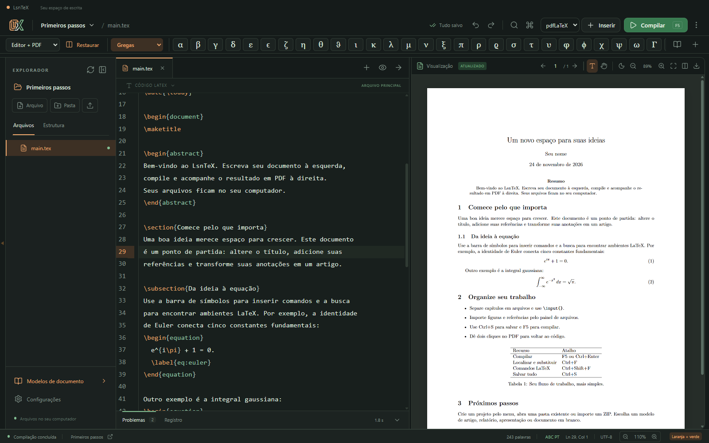
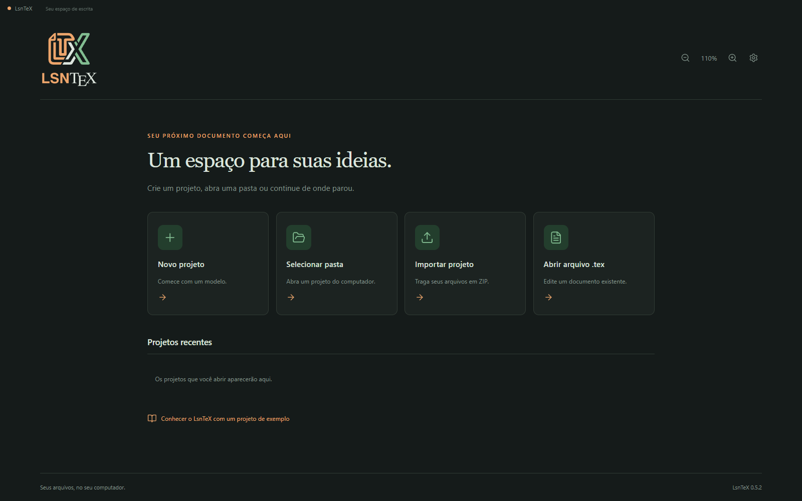
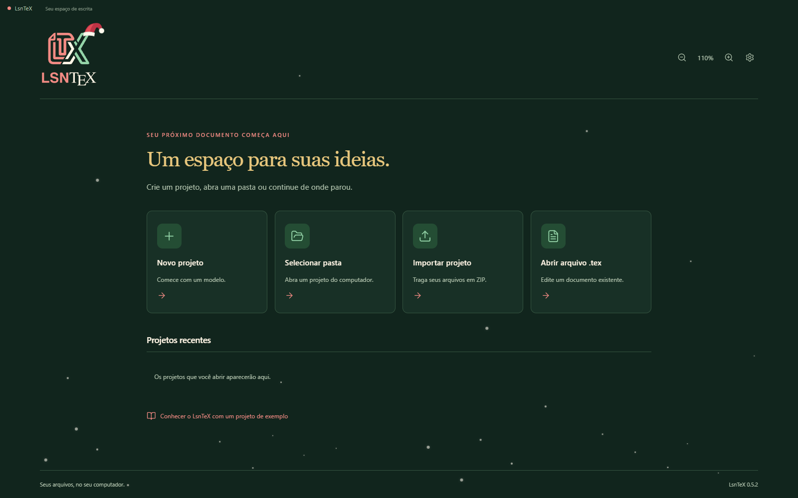
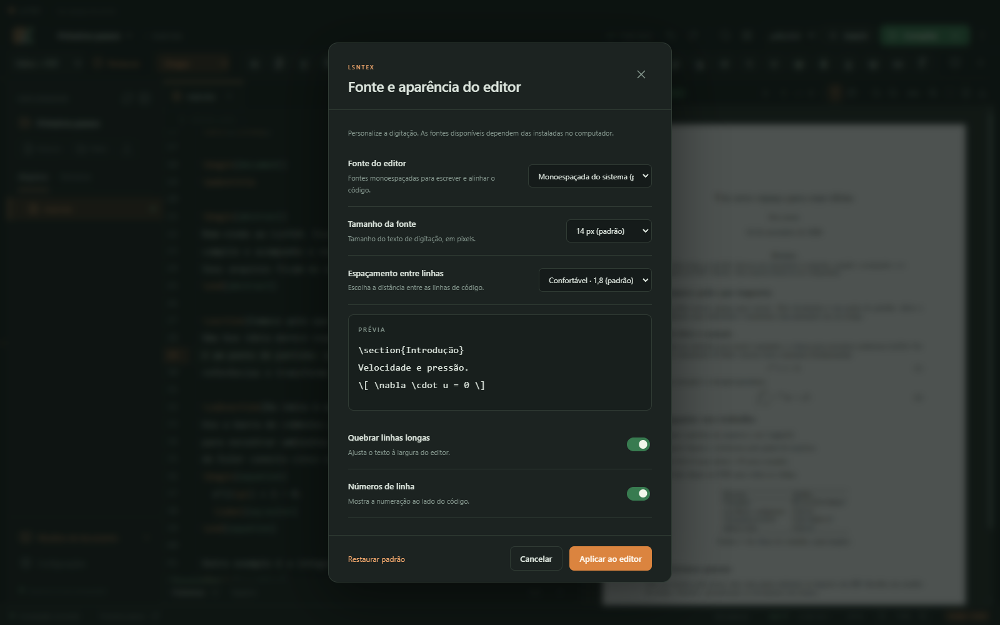
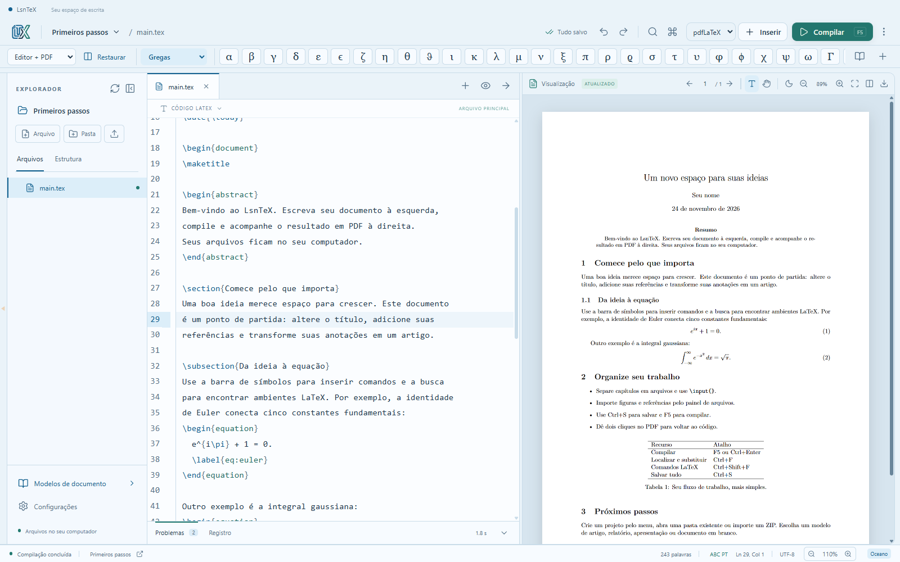

<p align="center"></p>

# LsnTeX

### Suas ideias, do código ao PDF.

Editor LaTeX em português para **Windows e Linux**, com projetos locais, visualização de PDF integrada e uma interface que você pode personalizar para escrever com conforto.

**[Baixar para Windows ou Linux](https://github.com/Ig80r/lsntex-releases/releases/latest)**



## Um espaço para escrever e organizar

- **Projetos no seu computador:** crie documentos, abra pastas, importe projetos ZIP e continue de onde parou pela tela inicial.
- **Editor personalizável:** escolha fonte, tamanho e espaçamento entre linhas, com prévia antes de aplicar. Organize o código com recuo automático, busca, abas e atalhos.
- **Correção ortográfica:** português e inglês, com sugestões e dicionário pessoal para nomes e termos científicos.
- **PDF integrado:** amplie com Ctrl + rolagem, arraste com a mãozinha, selecione e copie texto. Use a sincronização entre código e PDF para navegar pelo documento.
- **Símbolos à mão:** percorra as categorias com o mouse e crie seus próprios dicionários de comandos, com importação e exportação em JSON.
- **Modelos para começar:** artigos, relatórios, apresentações e exemplos de TikZ com figuras de fluidodinâmica.
- **Atualizações por escolha:** receba o aviso de uma nova versão do GitHub e decida quando baixar e instalar.



## Do seu jeito

O tema Clássico combina **laranja e verde**. Oceano, Ametista, Grafite e Aurora oferecem outras combinações, com modos claro e escuro. Ajuste o tamanho de toda a interface ou personalize apenas a fonte da digitação.

A nova logo acompanha as cores de cada tema. No **Natal**, o vermelho, o verde e o dourado ganham companhia de um gorrinho na ponta do X e neve animada na tela inicial.



Clique em **CÓDIGO LATEX**, acima do editor, para escolher sua fonte e experimentar os ajustes na prévia. Suas preferências ficam salvas para a próxima abertura.





## Downloads

| Sistema | Arquivo | Como usar |
| --- | --- | --- |
| Windows | [Instalador x64](https://github.com/Ig80r/lsntex-releases/releases/latest/download/LsnTeX-0.5.2-Instalador-x64.exe) | Instale e abra pelo atalho. |
| Windows | [Portátil x64](https://github.com/Ig80r/lsntex-releases/releases/latest/download/LsnTeX-0.5.2-Portatil-x64.exe) | Baixe e execute, sem instalar o editor. |
| Ubuntu / Debian | [Pacote .deb](https://github.com/Ig80r/lsntex-releases/releases/latest/download/LsnTeX-0.5.2-Linux-amd64.deb) | Instale com o gerenciador de pacotes. |
| Linux | [AppImage x64](https://github.com/Ig80r/lsntex-releases/releases/latest/download/LsnTeX-0.5.2-Linux-x86_64.AppImage) | Permita a execução do arquivo e abra o aplicativo. |

Para instalar o pacote no Ubuntu ou Debian, abra um terminal na pasta do download:

```bash
sudo apt install ./LsnTeX-0.5.2-Linux-amd64.deb
```

O LsnTeX compila os documentos com **MiKTeX ou TeX Live**. No Windows, prepara o MiKTeX automaticamente se nenhum compilador for encontrado e permite instalar os pacotes LaTeX conforme forem necessários. No Linux, o pacote `.deb` recomenda os componentes do TeX Live para os modelos incluídos.

## Comece seu documento

1. Abra o LsnTeX e escolha um modelo, uma pasta existente ou um projeto ZIP.
2. Escreva no editor e organize seus arquivos pelo explorador.
3. Pressione **F5** para compilar e acompanhar o resultado no PDF.

Seus arquivos permanecem em pastas comuns no computador. Para usar OneDrive ou Dropbox, escolha uma pasta já sincronizada pelo serviço.

---

**Projeto independente**, sem vínculo ou afiliação com o UaiTeX ou seus desenvolvedores. [Licença](LICENSE) · [Componentes de terceiros](THIRD-PARTY-NOTICES.txt)
