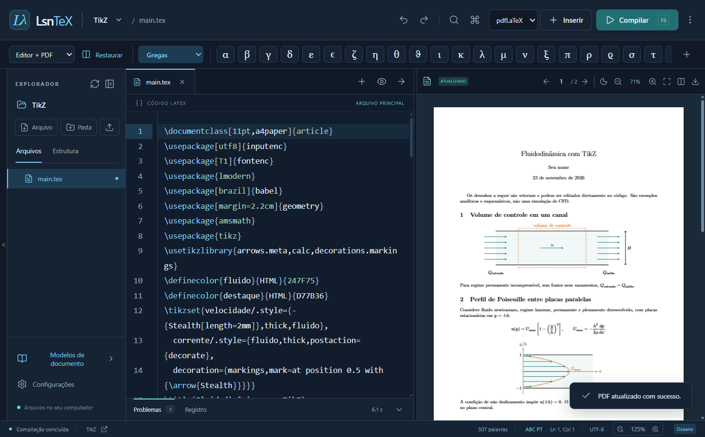
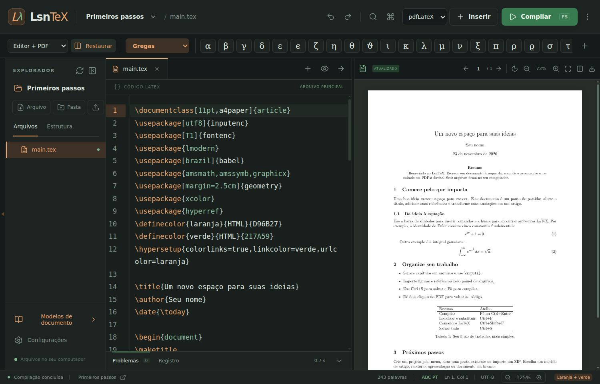

# LsnTeX

Editor LaTeX para Windows e Linux, em português, com projetos locais, visualização de PDF e temas personalizáveis.

**[Baixar a versão mais recente](https://github.com/Ig80r/lsntex-releases/releases/latest)** · [Todas as versões](https://github.com/Ig80r/lsntex-releases/releases)

Este repositório reúne os instaladores, versões portáteis e informações de distribuição do LsnTeX. Os arquivos automáticos “Source code” do GitHub contêm a documentação deste repositório; para usar o programa, baixe um dos pacotes da versão.

## Downloads

| Sistema | Arquivo | Uso |
| --- | --- | --- |
| Windows x64 | `LsnTeX-0.4.0-Instalador-x64.exe` | Instalação com atalho |
| Windows x64 | `LsnTeX-0.4.0-Portatil-x64.exe` | Executável sem instalação |
| Ubuntu / Debian amd64 | `LsnTeX-0.4.0-Linux-amd64.deb` | Instalação pelo apt |
| Linux x86_64 | `LsnTeX-0.4.0-Linux-x86_64.AppImage` | Aplicativo portátil |
| Linux x64 | `LsnTeX-0.4.0-Linux-x64.tar.gz` | Pasta portátil compactada |

Os pacotes não exigem Node.js. Instruções de uso e `SHA256SUMS.txt` acompanham cada versão.

## Recursos

- Projetos em pastas locais, importação e exportação de ZIP, arquivos e abas.
- Editor LaTeX com autocompletar, indentação, busca, símbolos, macros e atalhos.
- PDF integrado, zoom, restauração da visualização e SyncTeX nos dois sentidos.
- Correção ortográfica offline em português e inglês, sugestões e dicionário pessoal.
- Cinco paletas: Clássico, Oceano, Ametista, Grafite e Aurora, com aparência clara ou escura. Laranja e verde continuam como padrão.
- Escala de toda a interface, de 100% a 200%.
- Modelos de artigo, relatório, Beamer, carta e TikZ com exemplos de fluidodinâmica.





## Instalação

No Windows, execute o instalador ou a edição portátil. Se nenhum compilador for encontrado, o aplicativo pode baixar e instalar o MiKTeX para o usuário atual. Pacotes LaTeX ausentes podem ser instalados pelo MiKTeX durante a compilação. Essas opções exigem internet e podem ser desativadas.

No Ubuntu / Debian, na pasta do arquivo baixado:

```bash
sudo apt install ./LsnTeX-0.4.0-Linux-amd64.deb
```

O apt resolve as bibliotecas necessárias e recomenda os componentes do TeX Live que cobrem os modelos incluídos. No Linux, use o gerenciador da distribuição para instalar o compilador e seus componentes adicionais.

Para o AppImage:

```bash
chmod +x LsnTeX-0.4.0-Linux-x86_64.AppImage
./LsnTeX-0.4.0-Linux-x86_64.AppImage
```

Sem FUSE, acrescente `--appimage-extract-and-run`. Se a política de sandbox do sistema restringir aplicativos portáteis, prefira o `.deb`.

## Dados e compatibilidade

Os documentos ficam nas pastas escolhidas pelo usuário. Não há conta de nuvem própria ou colaboração online; pastas sincronizadas pelo OneDrive ou Dropbox podem ser usadas normalmente.

A versão Linux x64 foi testada no Ubuntu 24.04 pelo WSL2, com TeX Live. Outras distribuições e ARM64 ainda não foram testados. Os executáveis Windows não possuem assinatura digital comercial.

## Licenças

O LsnTeX é distribuído sob a licença MIT. Os pacotes incluem os avisos e licenças de seus componentes. MiKTeX e TeX Live são instalações independentes. Os arquivos `THIRD-PARTY-NOTICES.txt` e `FONTES-DICIONARIOS.txt` acompanham os releases.
